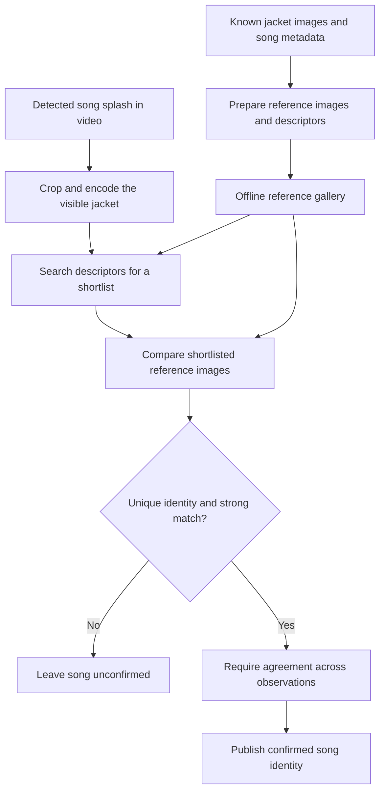

# How DDRCV encodes jackets and recognizes songs

A **jacket** is the square cover artwork shown for a song in Dance Dance
Revolution. DDRCV uses that artwork to identify the song appearing in a captured
video frame. Given a catalog of known jackets, it answers: “Which song does this
picture belong to?” This image-to-song search is the **reverse lookup**.

The algorithm first summarizes the picture's colors and edges to find promising
matches, then compares those candidates with the captured artwork in more detail.
It accepts a song only when the image match is strong enough and sufficiently
different from competing songs. During video playback, repeated observations
must agree before the application publishes the identity.

This overview describes the production CPU matcher in `ddrcv/jacket_lookup` as
of September 30, 2026. It uses deterministic image processing and a prepared
reference gallery, with no learned jacket model to train. For application setup,
see [Song and chart recognition](song_recognition.md).



## 1. Prepare a gallery of known artwork

Preparation associates reference images with song identities and chart metadata
from DDRCardDraw, the source of the artwork and song/chart records. The gallery
is built ahead of time and loaded locally for recognition, so a lookup needs no
network request.

Several details matter to the algorithm:

- **Duplicate files share an entry.** A SHA-256 checksum groups byte-identical
  artwork files, while retaining their original paths and song associations.
  This checksum identifies exact duplicates; visual matching uses the descriptor
  described below.
- **Artwork and song identity have different relationships.** Several jacket
  images can belong to one song, and one image can be associated with several
  song identities. Both relationships must survive preparation.
- **Reference geometry is consistent.** Supported images are resized to
  128 × 128 pixels. Historical rectangular banners are excluded from jacket
  matching because stretching them into squares would change their appearance.
- **Images are retained alongside descriptors.** The descriptor makes the first
  search inexpensive; the reference image supports the closer comparison.

The currently qualified gallery contains 1,577 square artwork entries. Production
searches this same full gallery for every event selection. Event membership is
checked later when resolving charts, so changing the event does not change the
visual competition between candidate songs.

The portable `.ddrcatalog` file holds the gallery, metadata, and matching profile.
Checksums and an encoder/gallery fingerprint bind the data to compatible
processing and acceptance rules. Refreshing chart metadata can reuse the
gallery; adding new reference artwork requires separate validation of the
gallery and its matching thresholds.

## 2. Encode a jacket as colors and edges

An **encoding**, or **descriptor**, is an ordered list of numbers summarizing an
image. The same procedure encodes both catalog artwork and an observed jacket.
Nearby descriptors suggest similar pictures; the original song identity remains
in the catalog metadata.

First, the jacket is resized to the shared 128 × 128 image plane. Many reference
jackets originate at 128 or 150 pixels, so this gives the reference and the larger
video crop a comparable scale. The encoder then makes a 24 × 24 thumbnail and
extracts two complementary descriptions:

| Component | What is measured | Why it helps |
| --- | --- | --- |
| Color layout | Three color-channel values at each thumbnail pixel, after subtracting the thumbnail's overall mean | Preserves where broad color regions occur and reduces sensitivity to a uniform brightness offset |
| Edge layout | Horizontal and vertical brightness changes, computed with Sobel filters on a grayscale thumbnail | Preserves the position and direction of boundaries, lettering, and shapes |

These descriptions preserve spatial layout: a red patch near the top occupies
different descriptor positions from a red patch near the bottom.

Each component is flattened and normalized to unit length, with a small
denominator floor for a zero-valued component. The color component receives a
weight of `0.85`; the edge component receives `0.35`. They are joined and
normalized again:

```text
descriptor = normalize(concatenate(0.85 × normalize(color),
                                   0.35 × normalize(edges)))
```

There are `24 × 24 × 3 = 1,728` color values and `24 × 24 × 2 = 1,152`
edge values, giving **2,880 numbers per jacket**. Normalization keeps vector
magnitude from dominating the comparison. The component weights favor broad
color layout while retaining structural evidence; they are not percentages.

New gallery builds use the portable encoder, which fixes intermediate precision
and the order of numerical reductions to avoid CPU-dependent descriptor rounding.
Supported older catalogs keep their corresponding encoder. Both implement the
same color-and-edge approach.

## 3. Search the descriptors for likely candidates

For a detected DDR WORLD song splash—the introduction screen before gameplay—
the pipeline takes a known jacket region from a standardized 1280 × 720 frame: a 429 × 429 square starting at pixel
`(425, 105)`, measured from the top-left corner. A caller can also supply an
already-cropped jacket. This fixed geometry is an assumption of the splash
pipeline.

After encoding the crop, DDRCV compares its descriptor with every reference
descriptor using a **dot product**. For nonzero vectors normalized to unit
length, this is cosine similarity: a larger value indicates better agreement
between the patterns of numbers.

All reference descriptors are rows in one matrix, so one matrix-vector operation
produces the similarities. The default lookup keeps the **16 best artwork
candidates** for verification. This direct scan is practical for the current
gallery size and avoids needing a separate approximate-search index.

This stage is a shortlist, not an acceptance decision. Two different jackets can
have similar color blocks and edges at 24 × 24 resolution. Conversely, a correct
reference that falls outside the shortlist cannot be recovered by the next
stage.

## 4. Verify candidates with image correlation

The second stage compares the actual 128 × 128 reference images with the resized
query. DDRCV removes a four-pixel border from the query, leaving a 120 × 120
interior, then slides that interior across each reference.

There are nine possible positions along each axis. Relative to the centered
alignment, this allows a translation of up to **four pixels in either direction**
at the 128-pixel scale. This accommodates small crop offsets and avoids relying
on the query's outermost border.

At each position, the matcher calculates normalized correlation in grayscale
and in color. Correlation measures agreement in image variation after accounting
for mean and magnitude. The verification score is:

```text
score = maximum over allowed positions of
        (0.80 × grayscale correlation + 0.20 × color correlation)
```

Both correlations use the same position before being combined. Grayscale
provides most of the score, while color helps distinguish otherwise similar
images. The candidates are then reordered using this verification score.

The verification score determines acceptance; the descriptor score was used to
choose the candidates. The limited sliding comparison accommodates translation,
but provides no general correction for rotation, perspective, or severe cropping.

## 5. Decide whether the evidence identifies one song

Before making a decision, DDRCV groups the verified candidates by **song
identity**, keeping each song's strongest artwork match. This prevents two
jackets belonging to the same song from competing against each other as the
winner and runner-up.

The matcher then considers two quantities:

```text
best score = strongest verification score
margin     = best score − score of the next-best distinct song
```

The runner-up is drawn from the verified shortlist. If there is no second
distinct identity, the implementation assigns a zero margin rather than treating
the absence of competition as evidence of certainty.

The current qualified profile requires a **best score of at least 0.40** and a
**margin of at least 0.28**. The leading artwork must also map to a known,
unambiguous song identity. Shared artwork is rejected even when its pixels match
very well; a picture shared by two songs cannot establish which song is playing.
Catalog preparation also tracks additional shared-artwork identities found in
updated metadata so they can block an otherwise accepted result.

For illustration, assuming known, unique artwork:

| Best score | Runner-up | Margin | Decision |
| --- | --- | --- | --- |
| 0.82 | 0.48 | 0.34 | Accept: both thresholds pass |
| 0.82 | 0.71 | 0.11 | Reject: two songs remain too similar |
| 0.37 | 0.05 | 0.32 | Reject: the best match itself is too weak |

These are illustrative numbers, not recorded measurements. A score of `0.82`
does not mean an 82% probability of being correct. The score and margin are
empirical comparison measures, with thresholds chosen for the qualified gallery.
The lookup can return candidate diagnostics while leaving the song unconfirmed.

## 6. Confirm the result in video and resolve the chart

A single accepted image lookup is one observation. During video processing,
DDRCV samples eligible splash frames at most five times per second and requires
at least two agreeing accepted observations spanning 200 milliseconds before
confirming a song. Rejected observations, a different identity, or a gap longer
than 750 milliseconds break an unfinished agreement sequence.

This reduces reliance on a single transitional frame. Once confirmed, the song
persists through gameplay and per-song results; song/session resets, source
changes, and seeks clear the stored identity. Repeated frames can still repeat
the same mistake, so temporal agreement supplements the image checks.

The jacket identifies a song. A **chart** is a particular sequence of steps for
that song. To identify it, DDRCV also needs the configured Singles/Doubles style
and each player's difficulty. Difficulty is read
separately, using label templates by default. These values select chart metadata,
including the chart's maximum EX score—the highest score possible under DDR's EX
scoring system.

A song can be recognized successfully while a player's chart remains unavailable
because it is outside the selected event pool, lacks a maximum EX value, or has
ambiguous metadata. The maximum score comes from the catalog; it is not inferred
from the artwork.

## What the evidence supports

The original comparison used five songs for calibration and six different songs
for held-out evaluation. Method selection and thresholds were frozen before
evaluating the held-out set. Controls included non-splash frames, transitions,
synthetic image degradation, and searches with the true reference removed.

In that full-gallery evaluation, all six held-out clean songs were accepted
correctly, with no false accepts in the evaluated controls. This is useful evidence
for the approach, but six songs from one capture domain cannot establish a broad
accuracy guarantee. Repeated frames and synthetic variants do not add independent
songs. See the [original findings](../experiments/jacket_lookup/REPORT.md) and
[production integration evidence](../experiments/jacket_lookup/INTEGRATION_REPORT.md)
for the measured scope.

The main limitations follow directly from the design:

- The reference gallery must contain suitable artwork and correct identity links.
  Unknown artwork still has a nearest neighbor, so rejection thresholds matter.
- Fixed crops assume the expected screen layout. Overlays, severe blur, glare,
  rotation, or perspective changes can remove or distort the evidence.
- Visually similar jackets can compete closely, and shared artwork requires
  additional evidence beyond the picture to separate identities.
- Updating the gallery changes the competing candidates and may change margins.
  Thresholds need validation with the gallery and capture conditions in use.

## Implementation pointers

| Part of the algorithm | Source |
| --- | --- |
| Descriptor construction and gallery encoding | [features.py](../ddrcv/jacket_lookup/features.py) |
| Splash crop geometry | [images.py](../ddrcv/jacket_lookup/images.py) |
| Descriptor search, correlation, identity grouping, acceptance | [lookup.py](../ddrcv/jacket_lookup/lookup.py) |
| Current score/margin profile | [gallery-portable.json](../ddrcv/jacket_lookup/assets/gallery-portable.json) |
| Gallery loading and selected-catalog checks | [assets.py](../ddrcv/jacket_lookup/assets.py), [selection.py](../ddrcv/jacket_lookup/selection.py) |
| Agreement across video observations | [service.py](../ddrcv/jacket_lookup/service.py) |
