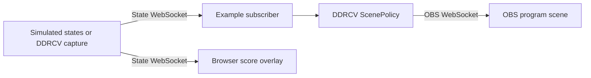

# State-driven OBS scenes

This runnable example creates an actual **DDRCV State Demo** scene collection in
OBS with three illustrated Browser sources. It demonstrates the path from a DDRCV
state snapshot to a scene change, including the
[score overlay example](../browser_overlay/README.md), unknown-state hold,
manual override, and reconnecting to the state feed. It lives outside the DDRCV
package and reuses its `WebSocketPublisher`, `ScenePolicy`, and `OBSService`.



The two sockets serve different purposes: **9010** is the example's simulated
state feed; **4455** is OBS control. Real DDRCV capture normally publishes on
**9000**. The example changes OBS's **program** scene, including in Studio Mode.

## Set up OBS

1. Use the repository's existing desktop/tournament Python environment, or install
   DDRCV with its `tournament` extra. Run the commands below from the repository
   root. No capture device, footage, OCR model, or external renderer is needed.
2. Open OBS Studio with Browser Source and obs-websocket support. Under
   **Tools → WebSocket Server Settings**, enable the server and note its port and
   password. Keep authentication enabled. See the
   [official OBS remote-control guide](https://obsproject.com/kb/remote-control-guide).
3. Stop any active stream, recording, replay buffer, or virtual camera before
   setting up or starting the example. The script checks this before making
   scene changes; it never starts or stops those outputs.
4. Create the demo collection:

   ```bat
   .venv\Scripts\python.exe examples\obs_scene_switching\demo.py setup
   ```

   Enter the OBS WebSocket password at the hidden prompt. Alternatively set
   `OBS_WEBSOCKET_PASSWORD` in the environment. Credentials are never written
   into the assets or the example. `--host` and `--port` select another OBS server.

Setup creates and selects **DDRCV State Demo**. It prints the previous collection
name so you can return to it through OBS's **Scene Collection** menu. It generates
local HTML and overlay assets under `.workbench/obs-scene-example/`, and adds:

| DDRCV state | OBS scene |
| --- | --- |
| `login`, `song_select`, `total_result` | DDRCV Demo - Lobby |
| `song_splash`, `song_playing` | DDRCV Demo - Gameplay |
| `song_result` | DDRCV Demo - Results |
| `unknown`, unrecognized state | Hold the current scene |

Unlike DDRCV's default map, this example gives song results their own scene to
make the transition visible. The generated `scene_map.json` contains this map.
Setup can be rerun: it reloads only this demo's named Browser sources, repairs missing
scene items, and retains other scenes/sources. Keep the generated files in place
because OBS refers to their absolute paths. After moving the checkout or assets,
rerun setup. `--assets` chooses another folder.

## Demonstrate a complete song

For one automatic cycle with rising gameplay scores:

```bat
.venv\Scripts\python.exe examples\obs_scene_switching\demo.py simulate --cycle
```

Watch the OBS program preview: **Lobby → Gameplay → Results → Lobby**. The cycle
also publishes `unknown` after results, demonstrating that the Results scene
holds. The console prints each published state and intended scene. When the
cycle exits, the feed closes and the Browser overlay visibly disconnects.

For an interactive demo, omit `--cycle`:

```bat
.venv\Scripts\python.exe examples\obs_scene_switching\demo.py simulate
```

At `demo>`, enter commands individually:

```text
song_select
song_splash
song_playing
scores 1234 1200
song_result
unknown
manual lobby
song_playing
auto
status
quit
```

`manual lobby` switches to Lobby and pauses automation. Publishing gameplay while
paused leaves Lobby on air; `auto` resumes and reconciles the latest state even
if no new message arrives. `manual gameplay` and `manual results` work too.
`cycle` runs the automatic sequence within the interactive session. `status`
shows feed connection, received state, current OBS scene, automation, and errors.
Use the example's manual commands to demonstrate override: an ordinary click
in OBS does not automatically pause this subscriber and may be reconciled back.

`quit` or Ctrl+C closes the example's connections and simulated publisher, leaving
OBS open at its current scene. Switching to another collection ends the follower
without trying to steer that collection. If OBS closes or its requests fail,
restart the example after resolving the reported error. A lost state feed is
retried automatically; the scene holds until a new valid snapshot arrives.

## Rig it to real DDRCV capture

Select the demo collection in OBS. Configure its Browser sources for the actual
feed, then start the subscriber:

```bat
.venv\Scripts\python.exe examples\obs_scene_switching\demo.py setup --feed ws://127.0.0.1:9000
.venv\Scripts\python.exe examples\obs_scene_switching\demo.py follow --feed ws://127.0.0.1:9000
```

Start DDRCV capture separately. **Disable the desktop/workbench's own OBS
automation while this subscriber runs**, so only one controller chooses scenes.
Do not run the simulated publisher on the same port as capture. For a custom
simulation port, use `setup --feed ws://127.0.0.1:9011` and
`simulate --feed-port 9011` together.

Alternatively, use DDRCV's existing desktop OBS integration directly:

1. Stop the example subscriber/simulator. Run `setup --feed ws://127.0.0.1:9000`
   once to point the Browser sources at the desktop publisher. Substitute the
   desktop's configured publisher port if it differs.
2. Open the desktop's **Advanced driver configuration**. Set `obs.scene_map` to
   the object in `.workbench/obs-scene-example/scene_map.json`, then choose
   **Use edited JSON**.
3. In the desktop **OBS** tab, enter OBS's host, port, and WebSocket password.
   Enable **Connect on Start** and **Enable scene automation on Start**.
   The OBS password belongs here, never in the Browser source's state-feed URL.
4. Select a capture source or a **Local video** containing a complete song, then
   press **Start**. A still image does not advance temporal recognition or scenes.
5. Confirm **Automating** in the OBS tab and watch the actual OBS program scene
   follow **Lobby → Gameplay → Results → Lobby**. Names read on the splash and
   accepted gameplay scores should appear in both the desktop and OBS overlay.
6. During gameplay, choose Lobby and press **Switch scene & pause automation**.
   The scene should hold while scores continue. **Enable automation** should
   restore Gameplay. **Disconnect** and **Connect** exercise OBS recovery;
   reconnect restores automation when **Enable scene automation on Start** is set.
7. Press **Stop**: OBS stays open and the overlay reports a disconnected feed.
   Press **Start** again: the Browser sources should reconnect automatically.

The scenes work with either controller.
For a live event, replace the illustrated cards with your sources and rehearse
the actual recognition and scene transitions. Simulation only validates wiring.

## Troubleshooting and tests

- Connection refused: OBS must finish startup, including any recovery prompt;
  verify its WebSocket server and port. Authentication failures mean the OBS
  password differs from the entered value/environment variable.
- Missing collection or scene: run `setup` first. A black Browser source can mean
  its generated HTML moved; rerun setup and refresh it.
- Correct scene but scores alternate between **Disconnected** and **Connecting**:
  the default demo setup points the cards at the simulator on **9010**, while
  desktop capture normally publishes on **9000**. Starting desktop capture does
  not change the cards' saved address. With OBS outputs stopped, run:

  ```bat
  .venv\Scripts\python.exe examples\obs_scene_switching\demo.py setup --feed ws://127.0.0.1:9000
  ```

  This updates and refreshes the Browser sources. Use the desktop's actual
  publisher port if it differs. For the standalone overlay, update its HTML
  `data-feed` and refresh the source. Scene control on **4455** and the score-feed
  connection are independent; successful scene switching does not prove that
  the cards have the right feed address.
- State feed messages are complete snapshots with no capture heartbeat; an open
  socket does not prove capture freshness. See the
  [state specification](../../doc/streaming_state.md).

Run focused tests without OBS or hardware:

```bat
.venv\Scripts\python.exe -B -m unittest discover -s tests -p test_obs_scene_example.py -v
```

These tests cover setup boundaries, idempotence, generated assets, simulation
snapshots, real WebSocket delivery, manual override, unknown-state hold, feed
reconnection, and stopping on collection changes. Actual OBS validation should
also inspect each rendered scene and compare it with the received state.

### Native desktop rehearsal

On 2026-09-20, the native Windows desktop (WebView2) and OBS 32.2.2 ran together
with an isolated desktop profile and a continuous recording of a complete song.
The desktop's own recognition, name OCR, state publisher, and OBS integration
drove the collection; the simulator and example subscriber were not running.
The actual desktop controls were exercised through its existing WebView2 instance.

The rehearsal confirmed Lobby → Gameplay → Results → Lobby, recognized names
`XETA` and `DANOOCT1`, changing scores, and final accepted gameplay scores of
1,615 / 1,632 in the native OBS Browser output. Manual override/resume, OBS
disconnect/reconnect, and capture Stop/Start with Browser-source reconnection
passed. An independent state-feed observer received 1,519 snapshots, and the
desktop reported no JavaScript errors. Local screenshots and the report are
under `.desktop-validation/desktop-obs/`; these machine-specific artifacts are
not distributed. OBS source settings and its selected scene were restored.

This was recorded-video integration validation. It did not exercise a live
capture device, streaming/recording outputs, the external renderer, or Discord.
